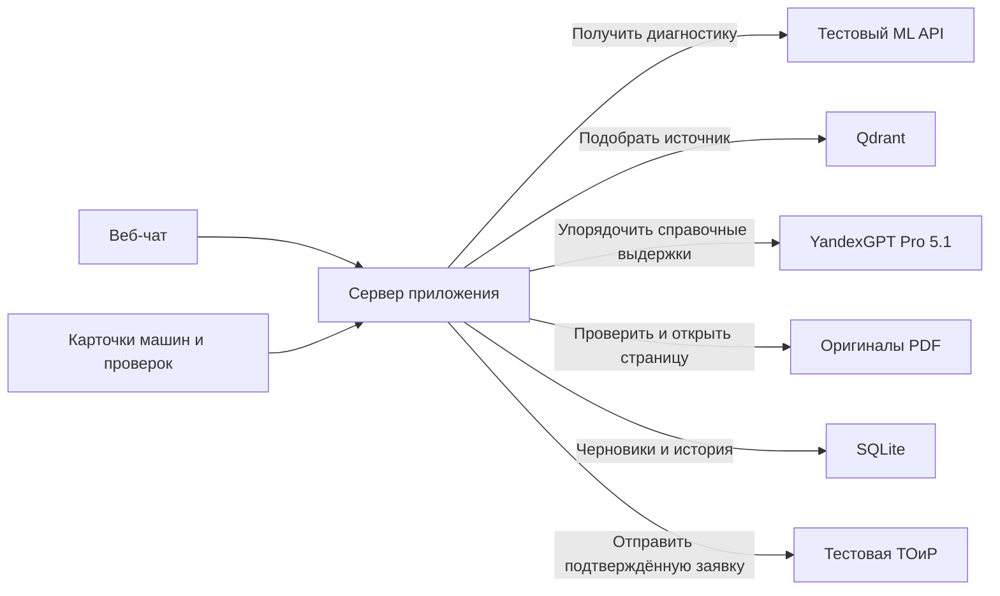

# Архитектура «Цифрового механика»

## Стек и среда выполнения

| Компонент | Реализация |
| --- | --- |
| Веб-интерфейс и сервер | HTML, CSS, JavaScript и Python 3.11+ со стандартным `http.server.ThreadingHTTPServer`. |
| Поисковые модели | `intfloat/multilingual-e5-small` в ONNX Runtime на CPU. `Qdrant/bm25` через FastEmbed с русской обработкой текста. |
| Справочные ответы | YandexGPT Pro 5.1 через Yandex AI Studio. Модель упорядочивает несколько проверенных выдержек. Сервер сохраняет их текст, ссылки и счётчики токенов ответа. |
| Подготовка базы знаний | PyMuPDF 1.26.7 для извлечения страниц и таблиц. Tesseract с `rus` для OCR. openpyxl 3.1.5 для экспертной таблицы Excel. |
| Хранение | Qdrant 1.19.2 в Docker с отдельным томом для индекса. SQLite в `data/state/work_orders.sqlite` для черновиков и истории. |
| Диагностика и ТОиР | Выданные тестовые сервисы с HTTP API, запускаемые через Uvicorn. |
| Стенд | Стенд развёрнут на ВМ Yandex Cloud с Ubuntu 24.04 LTS и Python 3.12.3. ВМ выделено 4 vCPU, 8 ГиБ ОЗУ и SSD 40 ГиБ. Caddy обслуживает публичный HTTPS. Веб-чат и тестовые API работают как службы systemd. |

Версии прямых зависимостей приложения указаны в `pyproject.toml`. [Зависимости Python](../pyproject.toml) · [Подготовка ВМ](../scripts/prepare-vm.sh)

## Диагностика и диалог

Сервер читает модель двигателя и историю проверок из `data/raw/vehicles.json`. При запросе `/api/diagnose` он сверяет выбранную пару «машина — проверка» и передаёт `vehicle_id` и `session_id` в `POST /diagnose`. Ответ содержит статус, код отклонения, признаки, уверенность и качество записи. Сервер отдельно обрабатывает норму, отклонение и непригодную запись. [Сервер](../src/ai_mechanic/web.py) · [Клиент ML](../src/ai_mechanic/ml_client.py)

Вопрос из чата поступает в `/api/ask`. Поиск всегда привязан к модели двигателя. В диалоге о выбранной проверке сервер может учитывать загруженную диагностику и уточнения механика, сохранённые для этой пары машины и проверки. [Сборка ответа](../src/ai_mechanic/ask.py)

Для вызова YandexGPT сервер передаёт справочный вопрос и пронумерованные выдержки. Он проверяет, что модель вернула все номера ровно по одному разу. При сбое остаётся исходный порядок. Диагностика и заявки обрабатываются локальными правилами приложения. [Клиент YandexGPT](../src/ai_mechanic/yandex_gpt.py)

## База знаний и поиск

Исходные PDF остаются доступны для проверки ссылок. При сборке индекса текст делится на абзацы, таблицы и части процедур. Разметка сохраняет связь с физическими страницами, моделью и исполнением. Сверенный OCR включается в корпус. Экспертная таблица привязывает коды неисправностей к источникам. Страница для дополнительной сверки сама по себе не обосновывает работу. [Подготовка фрагментов](../src/ai_mechanic/knowledge/qdrant_chunks.py) · [Импорт экспертных ссылок](../src/ai_mechanic/knowledge/expert_sources.py)

`intfloat/multilingual-e5-small` кодирует вопрос и текст локально через ONNX Runtime. Плотная ветвь Qdrant ищет по косинусной близости, разреженная использует русский BM25. Qdrant объединяет две выдачи методом RRF. В обеих ветвях действует фильтр по модели и известному исполнению. В текущей конфигурации поиск по плотным векторам точный. Индекс собирается в отдельной коллекции, затем приложение переключает её псевдоним после проверки числа точек. [Кодирование](../src/ai_mechanic/knowledge/_e5.py) · [Поиск и публикация индекса](../src/ai_mechanic/knowledge/_qdrant_store.py)

Поисковая модель оценивает сходство. Правила ответа проверяют предмет вопроса, условия процедуры и применимость нормы или работы. Сервер сверяет реквизиты источника с реестром, SHA-256 оригинала и существование страницы. Чат показывает физическую страницу PDF. [Отбор выдержек](../src/ai_mechanic/knowledge/search.py) · [Проверка ссылок](../src/ai_mechanic/knowledge/sources.py)

## Заявка и история

Черновик содержит машину, проверку, код отклонения, заключение, приоритет, работы, запчасти и ссылки. После правки списка работ сервер повторно проверяет его основание по руководству. Перед `POST /tickets` он проверяет принадлежность проверки машине и подтверждение текущей версии заявки. SQLite хранит текущую версию заявки, статус, время отправки и `ticket_id`. Неопределённый результат отправки получает отдельный статус `uncertain` для сверки по истории. [Черновики и история](../src/ai_mechanic/work_orders.py) · [Клиент ТОиР](../src/ai_mechanic/work_order_service.py)

Адреса тестовых сервисов задаются через `MOCK_ML_URL` и `MOCK_TOIR_URL`. Команды подготовки корпуса и запуска приведены в README. [Запуск веб-чата](../README.md#запуск-веб-чата)
